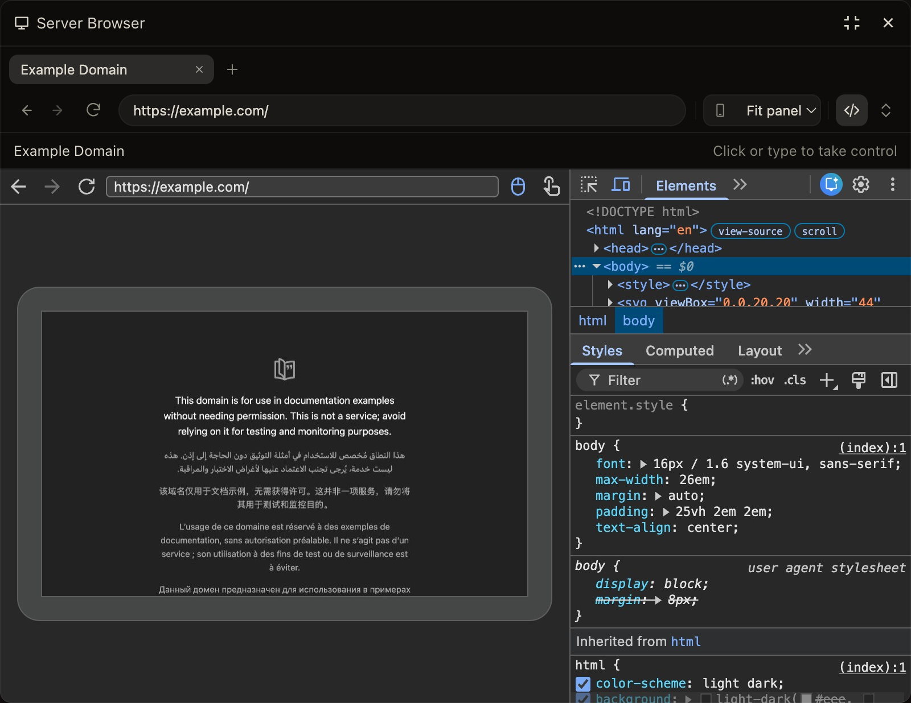

# Server Browser for OpenChamber

A real Chrome that runs on your OpenChamber server, shared by you and your agents. The agent browses with OpenChamber's `openchamber_web` tool. You watch the same page in a panel, step in when it needs a person (a sign-in, a captcha, a tricky form), and hand it back. Cookies, sign-ins, and form values carry over. You can also open Chrome DevTools on the page.



> **Experimental.** It works day to day but is still being checked across platforms. Each [release](https://github.com/JosueGalRe/openchamber-server-browser/releases) says what changed and what was tested.

## What you can do

- **Watch the agent work**, live, in the Server Browser panel.
- **Take over at any moment** by clicking or typing in the page. The agent waits until you hand control back.
- **Browse yourself** with tabs, an address bar, back, forward, reload, and phone, tablet, or desktop sizes.
- **Debug with Chrome DevTools**: Elements, Console, Network, and the rest, for the page you are looking at.
- **Keep chats apart**: every chat gets its own browser, with its own cookies and sign-ins.
- **Check on the browsers from Work Status**: what each one is doing, its errors, how much memory Chrome takes, and a button to close one. This needs OpenChamber 2.5.2 or newer.

## Requirements

- OpenChamber 2.0.1 or newer.
- Google Chrome or Chromium installed on the machine where OpenChamber runs. That is the server, which is your own computer only if OpenChamber runs there.

## Install

1. In OpenChamber, open **Settings → Extensions** and install from `https://github.com/JosueGalRe/openchamber-server-browser`, or install the ZIP from a [release](https://github.com/JosueGalRe/openchamber-server-browser/releases).
2. Approve its service. It is what starts Chrome on the server.
3. Under **Settings → General → OpenChamber Tools → Browser provider**, select **Server Browser**.
4. In a chat, ask the agent to open a page. Then open **Server Browser** from the panel rail.

To update, use **Update** in Settings → Extensions when a new version is offered, and back up your `config.json` first if you made one. The release notes say whether you need to approve the service again.

## Using it

### Let the agent browse

Ask in a chat, for example "Open https://example.com and tell me what it says." The agent uses `openchamber_web`, and the page appears in the Server Browser panel. To start the browser yourself, open the panel and click **Open for this chat**.

### Take over and hand back

- **Taking over.** Click, type, scroll, or paste in the page and you have control; that first click also reaches the page.
- **While you hold control**, the agent's browser actions wait. Click **Hand back to agent** when you are done.
- **Copy and paste.** Copy with Cmd/Ctrl+C or by right-clicking and choosing Copy. Double-click selects a word and triple-click a line. Paste works as usual.

### Inspect with Chrome DevTools

Click the `</>` button in the toolbar. You get the page on the left and DevTools on the right. Clicking and highlighting work on both sides. Click `</>` again to go back to the page. When the panel is narrow, maximize it, or hide the page pane from DevTools' own toolbar.

For a quick look instead, the error count inside the address bar lists the page's errors and warnings. **Browser inspector**, under **Extension pages** in the sidebar, shows the console and network requests.

### Open a local development server

Local and private addresses, such as `localhost:3000` or `192.168.1.20`, are blocked by default. To allow yours, create a `config.json` in the extension's installed folder; the blocked-address page shows its exact path:

```json
{
  "allowedOrigins": ["http://localhost:3000"]
}
```

Or add `"discoverDevServers": true` to allow any development server running on the server. Restart the extension after editing the file. [Configuration](docs/configuration.md) covers the other options and what each one allows.

## Troubleshooting

| You see | What to do |
| --- | --- |
| A page saying the address is blocked | Allow it in `config.json` as above, then restart the extension. |
| The agent says the user controls the browser | You took control by clicking in the page. Click **Hand back to agent**. |
| The agent's `browser.tabs.open` or another `browser.*` tool fails with `browser.disconnected` | Those are OpenCode's own browser tools. Ask the agent to use `openchamber_web`. |
| The panel asks you to open the chat's browser, and the toolbar is greyed out | This chat has no browser yet. Click **Open for this chat** or ask the agent to open a page. |
| "Chrome or Chromium was not found" | Add `"chromePath": "/path/to/chrome"` to `config.json`. |
| A dropdown (`<select>`) does not open | Chrome draws those menus outside the page. Turn on the last toolbar button, "Show native select menus". |
| Copy shows a notification instead of copying | Click its **Copy** button. Your browser did not let OpenChamber write the clipboard directly. |

## Good to know

- **Browsers are temporary.** A chat's browser closes after five minutes unused, and its cookies and sign-ins go with it. Restarting OpenChamber does the same. `idleMinutes` in `config.json` changes the five minutes.
- **Up to four chats** can have a browser at once. `maxScopes` in `config.json` changes the four.
- **The browser runs on the server.** So `localhost` means the server, not your laptop.
- **Everyone with the panel sees the same browser.** It is not a privacy barrier between people sharing one OpenChamber.
- **Sites see regular Chrome.** That is what lets Google sign-in work, and it also means sites cannot tell that an agent may be driving.

## More

- [How it works](docs/how-it-works.md): agent actions, tabs, sizes, DevTools, and lifetimes in detail.
- [Configuration](docs/configuration.md): allowing local servers and networks, discovery, and a custom Chrome.
- [Security](docs/security.md): what the extension isolates and what it trusts.
- [Parity and roadmap](docs/parity.md): how this compares with the original Server Browser in [OpenChamber PR #3425](https://github.com/openchamber/openchamber/pull/3425), and what remains.
- [Development](docs/development.md): building, testing, releasing, and what has been validated.

## License

Adapted from OpenChamber under the MIT license. See [LICENSE](LICENSE), [NOTICE](NOTICE), and [THIRD_PARTY_LICENSES](THIRD_PARTY_LICENSES).
